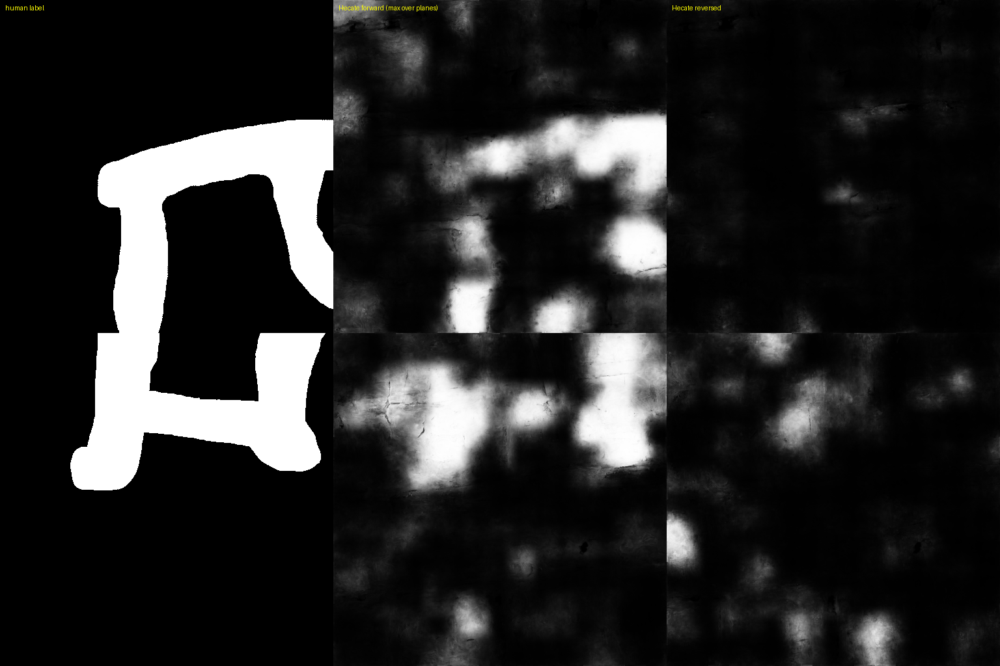

# Render direction and intensity checks for surface-conditioned renders

Three small, dependency-light checks that decide whether a surface render is fit to feed to an ink model, before any model is trained or judged:

| script | question | needs |
|---|---|---|
| `direction_check.py` | Does depth run the way the model expects (forward) or reversed? | two 2-D maps (model on the render as is, and with planes reversed) and any independent reference map |
| `layer_order_check.py` | Is my render's plane k the published stack's plane k, or plane N-1-k? | two stacks of the same window (`.npy`) |
| `intensity_check.py` | Is the intensity distribution the one the model was trained on? Prints the normalisation. | one stack (`.npy`) |

## What is your contribution?
1. **Scroll data used.** Scroll 5 (one published mesh, one 800 x 1600 window, model `wild15`) for the layer-order / intensity finding; Scroll 1 (PHercParis4) and Scroll 4 (PHerc1667) surface renders for the direction check.
   No eligible-prize-scroll data is used or shown.
2. **Why it raises the chance of reading scrolls.** A depth-aware ink model reads chance on a render whose plane order or intensity differs from its training data, and nothing in the output says so.
   We lost a whole scroll's worth of ink-detection work to exactly this: AUC 0.52 on the render as produced, 0.87 with the plane order reversed, 0.92 once the intensity was normalised (the published stack scores 0.91).
   These checks find the problem in seconds, per segment, from outputs that already exist.
3. **What it enables that was not possible before.** An automatic, model-agnostic orientation verdict (forward / reverse / ambiguous) with the evidence shown per block, and a stack-vs-stack plane-order test.
   Hecate's model card tells you to "run both directions into different output files if the direction is unknown"; `direction_check.py` is the step after that: which of the two files to keep.
4. **Evidence** (real data):

### Scroll 5: render order and intensity (same mesh, same window, same model)
| stack | AUC vs human label |
|---|---|
| our render of the published mesh, as produced (middle plane mean 87 / std 32; published 150-159 / 20-25) | 0.521 |
| same, plane order reversed | 0.868 |
| same, reversed + material intensity normalised to mean 150 / std 25 | **0.921** |
| the published layer stack itself | 0.910 |
Our layer k matched published layer 64-k (correlation 0.88-0.93); at layer 32 the two matched at 0.92 with no flip and no depth offset.

### Scroll 1 and Scroll 4: Hecate 9.6 um 3-D output, forward vs reversed (512 x 512 px tiles, own-sheet ink columns at p >= 0.5; Pearson r of the max-over-planes map with the human label)
| scroll | tiles | ink columns forward | ink columns reversed | r with human label, forward | reversed |
|---|---|---|---|---|---|
| Scroll 4 | 5 | 16,436-33,770 | 0-13,565 | 0.36-0.64 | -0.07-0.14 |
| Scroll 1 | 5 | 11,657-23,478 | 0-1,854 | (no S1 label in the tiles) | |
Forward is the right direction for all ten tiles; the reversed pass is not empty on four of the five Scroll 4 tiles (up to 13,565 columns), which is why a count is not enough and the per-block comparison against a reference is used.

*Human label | Hecate forward | Hecate reversed, Scroll 4 tiles 20251208130119 (top) and 20251212185248 (bottom), 512 px: the forward pass reproduces the labelled strokes, the reversed pass does not.*

### `direction_check.py` run on the five Scroll 4 tiles (forward / reversed Hecate max maps against the human label, 128 px blocks)
| tile | blocks | mean r forward | mean r reversed | blocks where forward is better | verdict |
|---|---|---|---|---|---|
| 20240304144031 | 9 | 0.392 | 0.076 | 0.89 | fwd |
| 20240304161941 | 11 | 0.355 | -0.032 | 1.00 | fwd |
| 20251208130119 | 9 | 0.598 | 0.012 | 1.00 | fwd |
| 20251212185248 | 7 | 0.628 | 0.180 | 1.00 | fwd |
| 20251223230000 | 7 | 0.450 | 0.121 | 0.86 | fwd |

## Limits
- The verdict needs a reference map that is independent of the direction (another model's 2-D map or a label); on a surface with no signal it returns "ambiguous".
- `layer_order_check.py` and `intensity_check.py` are tested on synthetic stacks only (`tests/`); the Scroll 5 numbers above were measured with the original in-house scripts and are reported, not re-derived here.
- Single window for the Scroll 5 table.
