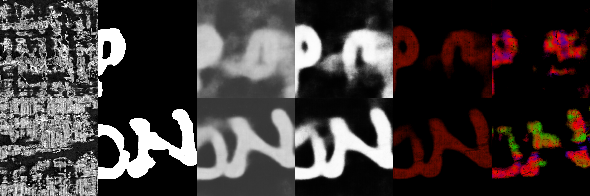
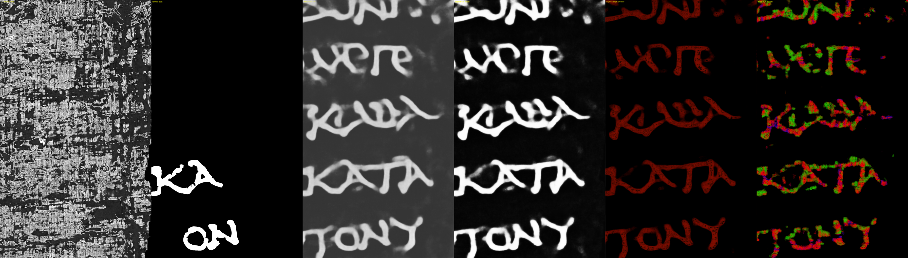

# Sheet-localised 3-D ink head for a reader-v3-style ink model

A 2-D ink U-Net (reader-v3: 3-D depth-fusion stem + 2-D U-Net, 17 input planes at ~9.6 um) says *whether* a pixel carries ink.
This contribution adds a 16-plane **depth head** (a 1x1 conv on the finest decoder stage) that says *on which plane / sheet*, trained **without any 3-D human label**:
the 2-D label is snapped onto the ink-bearing sheet using a teacher's depth profile (Hecate 9.6 um), restricted to +-`film` planes around the teacher's peak, so ink on the
neighbouring sheets is never a target. Cost is about 1/25 of Hecate per mm^2 (reader-v3 ~23 GMAC/mm^2 vs Hecate ~565 GMAC/mm^2).

## What is your contribution?
1. **Scroll data used.** Training / teacher volumes: 13 open-data segments, 8 of Scroll 1 (PHercParis4: 20230702185753, 20230929220926, 20231007101619, 20231012184424, 20231016151002, 20231031143852, 20231106155351, 20231210121321) and 5 of Scroll 4 (PHerc1667: 20240304144031, 20240304161941, 20251208130119, 20251212185248, 20251223230000), 9.6 um surface renders (17 planes) with Hecate 9.6 um teacher volumes; labels = refined core (human label AND the registered upstream 2.4 um prediction >= 128, 'maybe' pixels excluded); the right 10 % of each segment is held out. Every batch is also mixed with ~9 windows of the unified reader-v3 training store (per-scroll counts 0139 x2, others x1, x in [0, 0.88)), i.e. the stock model's own training data. Initialisation: the stock reader-v3 checkpoint. No other data. The test segments (PHerc0009B, 0139, 0500P2, 0814, 0841) are not among the 13; the store mix is the same data the stock model saw, including the 5 representations that overlap 3 test segments (see the leakage-audit branch), so stock and fine-tuned models are equally exposed.
   Evaluation: the 8 upstream test segments listed in the reader-v3 README (human-label AUC, equal weights), through the same harness for every row. No eligible-prize-scroll data is used or shown.
2. **Why it raises the chance of reading scrolls.** In overlapped / crushed regions a 2-D model paints ink from the neighbouring sheet onto the sheet being read. A depth head that is trained to
   put ink on the sheet the mesh intends gives a reader-v3-cost model that can (a) be run over whole scrolls, (b) report the depth at which each stroke sits, and (c) be compared against
   other 3-D models with the leakage metrics below. On the upstream test the fine-tuned models score slightly higher than the stock model, but most of that gain is also present in the single-task control (table below); the part attributable to the depth head is within about two seed standard deviations.
3. **What it enables that was not possible before.** (i) Per-pixel sheet/depth localisation from a model that costs about the same as the reader-v3 you already run, with no 3-D labels;
   (ii) a controlled ablation of *where* depth supervision should be allowed (+-1 plane around the teacher's peak vs any plane): limiting it to the sheet is better;
   (iii) a leakage measurement (`sheet_leakage_metrics.py`) that compares sheet maps against a laterally shifted null, usable for any 3-D ink output.
4. **Evidence** (all on real data; one training seed per row unless stated; replicate seeds are running and will be appended to this file):

*Columns: CT middle plane | refined human core label | stock reader-v3 probability | depth-head model probability | depth-head depth hue (blue = top plane, red = mesh plane, green = bottom plane) | Hecate depth hue. Rows: Scroll 4 20251212185248 (window y 3072, x 7040) and Scroll 1 20230929220926 (window y 3328, x 17568), 512 px at 9.6 um. The windows are in the held-out right 10 % band of segments the model was fine-tuned on, so the sharper probability map reflects fine-tuning to the refined labels as well as the head; the transfer evidence is the table below. Look at the last two columns: Hecate spreads ink over several depths (blue/green/red), the film +-1 head keeps it on the mesh plane (red).*

*Wide patch, 29.5 x 17.2 mm (3072 x 1792 px at 9.6 um), Scroll 1 20230929220926, y 768, x 17056; same column order as above. Inside the held-out right 10 % band of segments the model was fine-tuned on (same caveat).*

### Upstream test (8 segments, human-label AUC, equal weights, last checkpoint)
| model | P384 | P448 |
|---|---|---|
| stock reader-v3, same harness (positive control; README reference 0.892 at P384) | 0.8893 | 0.892 |
| single-task control (same data and recipe, depth head not trained) | 0.8911 | 0.8941 |
| **depth head, film +-1 plane** (seed 0) | **0.8968** | **0.8994** |
| depth head, film +-1 plane (seed 1) | 0.8947 | 0.8957 |
| depth head, film +-1 plane, 13 segments (seed 2) | 0.8968 | 0.8991 |
| depth head, film +-1 plane (seed 3) | 0.8953 | 0.8964 |
| depth head, film +-1 plane (seed 4) | 0.8924 | 0.8955 |
| **film +-1, mean of seeds 0, 1, 3, 4 (n = 4 runs)** | **0.8948 (sd 0.0020)** | **0.8968 (sd 0.0017)** |
| depth head, film +-3 planes | 0.8933 | 0.8953 |
| depth head, any sheet (3-D target = teacher probability on every plane, 2-D = max over depth) | 0.8841 | 0.8871 |

Reading: every film +-1 run is above stock (+0.0031 to +0.0075 AUC at P384; mean +0.0055). The control (one seed so far; two more are training) is already +0.0018 above stock, so the fine-tuning recipe explains about a third of the gain and the depth head about +0.0037 (P384) / +0.0027 (P448) on top, i.e. roughly 1.5 to 2 seed standard deviations: suggestive, not established. The any-sheet variant is *below* stock. n = 8 test segments per cell; no confidence interval over segments yet.

**What this model is and is not.** It is a 2-D U-Net with a 3-D depth-fusion stem (reader-v3) plus a per-pixel 16-value depth profile read from the 2-D decoder features. It is *not* a volumetric (3-D decoder) network: lateral and depth context are fused only in the stem. The depth profile is trained to peak within +-1 plane of the mesh, so its peak lies on the mesh plane by construction; it can not by itself detect that the mesh sits on a neighbouring sheet. Where a mesh is off the ink sheet the head would still report the mesh plane (not measured on real meshes yet). The independent sheet check is the teacher (Hecate) peak offset or the winding-overlap measurement, not this head's argmax.
Earlier versions of this recipe that (a) normalised with (x-150)/25 instead of the reader-v3 robust-MAD recipe and (b) trained on the S1/S4 stream only scored 0.749-0.795 on the same test:
**the store mixing and the optimiser (SGD nesterov, not AdamW) are required**; both are in `train_depth_head.py`.

### Leakage between adjacent sheets (sheet_leakage_metrics.py; Pearson r of per-sheet max-projected ink maps, own vs +-1 sheet, next to a map rolled 97 px = the null)
| model / data | own vs +-1 sheet | null |
|---|---|---|
| official 3-D student, S1, 5 windows of 512 px | -1 side 0.067-0.145 (mean 0.110); +1 side -0.087-0.175 (mean 0.042) | mean 0.027 / 0.012 |
| Hecate 9.6 um forward, S4, 5 segments | 0.23-0.44 | -0.03-0.11 |
| Hecate 9.6 um forward, S1, 5 segments | -0.13-0.09 (null level) | -0.06-0.15 |
Hecate writes ink in a column about 19 um thick (median; p90 38-58 um) on S4 and about 10 um on S1; its input window is 16 planes (154 um) and its gradient receptive field fills the whole 16 x 64 x 64 patch.

## Files
- `depth_head.py` - the head, the snapped target and the masked loss (torch only; tests in `tests/`, synthetic tensors, check the masking and the film restriction).
- `train_depth_head.py` - fine-tuning loop with plug-in net and aux-data factories; writes `datasets.json` (train segments, held-out band, aux source) before step 1.
- `hecate_teacher_volumes.py` - Hecate 9.6 um volumes for a whole surface-render zarr, banded and resumable.
- `sheet_leakage_metrics.py` - the adjacent-sheet coupling metric with its shifted null.

## What is NOT shown
- Tested with the reader-v3 network in our own harness (same architecture as the upstream `vesuvius.ink_detection` model); not yet run through the `vesuvius` package loaders: `--net-factory` is the adapter point.
- Held-out 2-D AUC inside the training segments saturates at stock level and is *not* a transfer measure; use the upstream test.
- One seed per arm for the table above; no confidence intervals.
