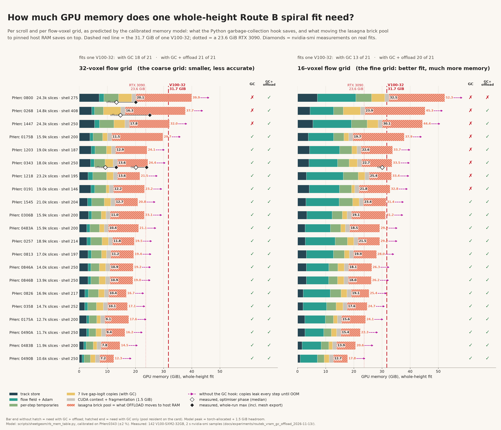
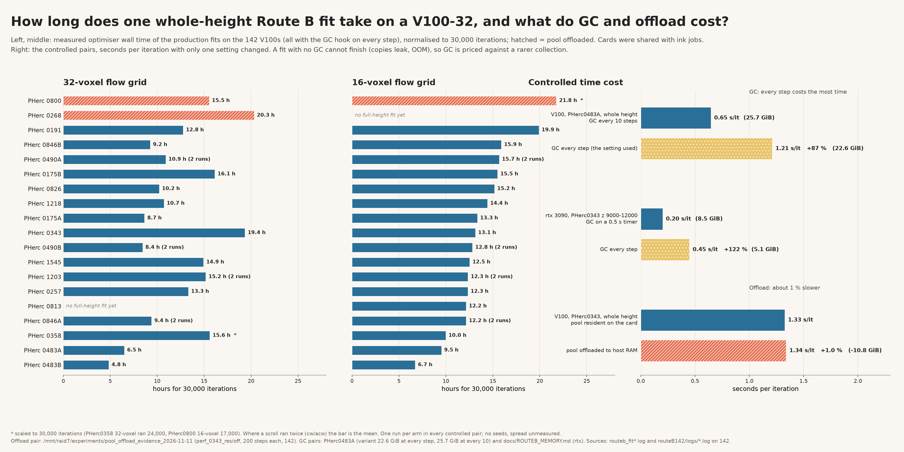

# Fit whole scrolls on a 32 GB card: host-RAM offload of the lasagna brick pool (and a GC hook)

**In one sentence:** with one environment variable, `fit_spiral.py` keeps its lasagna brick pool in pinned host RAM instead of on the GPU, so a full-height spiral fit of a tall or high-shell scroll fits a 32 GB V100 that it did not fit before, at about 1 % extra time per iteration where it was measured.

**One real example:** starting with PHerc0268 (14,833 slices, shell 408, a 21.4 GiB lasagna pool, predicted 37.7 GiB resident (model peak 36.2 GiB plus 1.5 GiB headroom, `docs/ROUTEB_MEMORY.md`), so it does not fit a 31.7 GiB V100-32) and its extracted tracks, I ran `fit_spiral.py` over the whole height with `FIT_SPIRAL_POOL_OFFLOAD=1`, and a 600-iteration probe measured 0.425 it/s with a 25,720 MiB (25.1 GiB) peak on one V100-32; the production fit then ran to completion and wrote a fitted checkpoint and meshes (queue claim to checkpoint about 21 h, including queue waiting).

**Before:** a V100-32 runs out of memory on the whole-height fit of PHerc0268 (the memory model predicts 37.7 GiB resident including 1.5 GiB headroom, against 31.7 GiB total). Measured 2026-11-11 on an otherwise empty V100-SXM2-32GB with the production recipe and GC hook but without the offload: the process held 30.4 GiB after the first iteration and died with `CUDA out of memory` (peak 31,116 MiB of 31.73 GiB) at iteration 1 of 150. PHerc0800 (39.9 GiB predicted) was not run resident. The only options were a larger card or fitting z-lanes separately and joining them, which leaves winding-identity seams.

**After this PR:** `FIT_SPIRAL_POOL_OFFLOAD=1` replaces `sparse_cuda_cache.ResidentBrickPool` at import time. The brick table, the index arithmetic and the output stay on the GPU; only the uint8 pool bytes live in host RAM that is page-locked and mapped into the card's address space. A small NVRTC kernel reads the requested voxels over PCIe, with no CPU gather and no host synchronisation. The gathered values are bit-identical. Default OFF; without the variable nothing is patched. The fitter file itself is not edited.

**Proof:** (all measured on one 8 x V100-SXM2-32GB host, production fit recipe: 32-voxel flow grid, 24,000 tracks per step, gc hook every step)

| fit | slices | shell | pool | it/s (one 200-step interval, steps 200 to 400) | GPU MiB median over the run / max (nvidia-smi, 2 s samples, whole run including start-up) |
|---|---|---|---|---|---|
| PHerc0343, pool on the card | 0-18000 | 250 | 10.81 GiB on card | 0.754 | 20,582 / 24,554 |
| PHerc0343, pool in host RAM | 0-18000 | 250 | 10.81 GiB in host RAM | 0.747 (+1.0 % time) | 9,522 / 13,514 |
| PHerc0268, pool in host RAM | 0-14833 | 408 | 21.43 GiB in host RAM | 0.425 | 15,004 / 25,720 |
| PHerc0800, pool in host RAM | 0-24298 | 275 | 19.79 GiB in host RAM | 0.555 | 13,544 / 20,596 |

- **Direct resident-vs-offload probe, PHerc0268, 2026-11-11, 142 card 6, 150 iterations requested, same dataset, recipe and GC hook (only the offload differs):** offload on: peak card memory 25,876 MiB, peak host RSS 100,614 MiB (about 98 GiB, of which about 21 GiB is the pinned pool and the rest track loading), the 150 iterations completed at 0.3 it/s; offload off: died at iteration 1 with CUDA OOM at 31,116 MiB peak card memory, peak host RSS 78,500 MiB (about 77 GiB). One run each; the offload run was started after loading 47 M tracks took 22 minutes (the track load dominates the 56-minute probe wall time).
- Memory saved on 0343: 11,060 MiB (median over the run), equal to the 10.81 GiB pool; 11,040 MiB at the maximum.
- PHerc0268 and PHerc0800 are the two scrolls that did not fit before; both completed a whole-height fit (checkpoint plus meshes). Resident runs of them were not attempted (the memory model, calibrated within 2 % on 0343, says they cannot fit).
- **Values are identical.** `t_gather.py` gathers 1 k / 100 k / 1 M / 4 M random indices from the same pool sidecar through the upstream `ResidentBrickPool` and through the offload pool: `identical: True` at every size (re-run on this branch's files against upstream `sparse_cuda_cache.py` at base 740f0103b, 2026-11-10, shared card; PHerc0343 normals+gradient pool, z 2000-2600, 27,435 bricks, 1.67 GiB). In a 400-step fit with `FIT_SPIRAL_POOL_OFFLOAD_VERIFY` on, 400 gathers (3,789,600 lookups x 2 channels) matched the resident copy with 0 mismatched values.
- Gather time per call, resident vs offload, ms (unshared card, original run): 2.3 / 2.4 at 1 k, 2.5 / 3.9 at 100 k, 3.0 / 29 at 1 M, 7.6 / 139 at 4 M lookups. Zero-copy over PCIe is 7x faster than the CPU-gather alternative measured first (214 ms per 1 M).

**Why / where this is useful:** anyone fitting scrolls that are tall or have many windings (the memory table puts 0268 at about 38 GiB and 0800 at about 40 GiB of the full-height fit) on a 24-32 GB card; it replaces "buy a bigger card or fit lanes separately" with host RAM (20-21 GiB of pinned RAM per fit on the test host, 754 GB total). The same directory carries the GC hook that cured the larger problem (below).

- [ ] I personally verified that the example and proof above were produced by this PR on the stated data. *(to be ticked by the submitter)*

## Memory and time per scroll (model, with the measured runs overlaid)



- Per scroll and per flow-voxel grid: the whole-height fit's GPU memory without the offload (bar end including the hatched pool) and with it (bar end before the hatch), against the 31.7 GiB of a V100-32. Table: [`charts/vram_per_scroll.md`](charts/vram_per_scroll.md), CSV next to it.
- Model: pool + tracks + flow field + 7 live gap-logit copies + per-step temporaries + 1.5 GiB headroom, calibrated on one scroll at full height (predicted 20.5 / 28.8 GiB against measured 20.1 / 28.2 GiB for the 32- / 16-voxel grid). Measured diamonds (nvidia-smi, 2 s samples): optimiser phase median, and the whole-run maximum, which includes the final mesh export (+4 to +10.5 GiB on the three scrolls measured; not in the model).
- By the model, on one V100-32: with the GC hook alone 18 of 21 scrolls fit at the 32-voxel grid and 13 of 21 at the 16-voxel grid; with the offload as well all 21 fit at 32-voxel and 20 of 21 at 16-voxel. The one that does not is the tallest one in the set (24,298 slices, shell 275): the model needs 32.5 GiB there, 0.8 GiB over the card. A 17,000-iteration fit of it at the 16-voxel grid with the offload did complete on a shared card; its own peak was not recorded, so that is not a measurement.
- Measured, 32-voxel grid, GC on, V100-32 (optimiser median / whole-run max): resident pool 20.1 / 24.0 GiB, offloaded 9.3 / 13.2 GiB (same fit, 18,000 slices); offloaded 14.7 / 25.1 GiB (14,833 slices, shell 408) and 13.3 / 20.1 GiB (24,298 slices, shell 275). No finished fit at the 16-voxel grid with the offload has a memory trace yet, so the 16-voxel bars are model predictions.



- Left and middle: measured optimiser wall time of the whole-height fits on V100-32 cards (all with the GC hook on every step), normalised to 30,000 iterations; cards were shared with other jobs.
- Right (controlled pairs, one run per arm, no seeds): the GC hook collecting every step costs 1.21 s per iteration against 0.65 s collecting every tenth step on a whole-height fit (+87 %, 22.6 GiB against 25.7 GiB peak); the pool offload costs 1.34 s against 1.33 s per iteration (+1.0 %) while freeing 10.8 GiB. Without the GC hook a fit cannot finish (the copies leak until out of memory), so the GC time is priced against a rarer collection, not against none.

## Details

### Files
- `rb_offload.py`, `cuda_rt.py`: the offload pool (cuMemHostRegister DEVICEMAP, NVRTC gather kernel).
- `sitecustomize.py`: the delivery hook. Put this directory first on `PYTHONPATH` of the fit process and set `FIT_SPIRAL_POOL_OFFLOAD=1`; a meta-path finder replaces `ResidentBrickPool` when the fit imports `sparse_cuda_cache`. It acts only in processes whose command line contains `fit_spiral`. `FIT_CHAIN_HOOK=<path>` chains another `sitecustomize.py` (for example the GC hook).
- `t_gather.py`: gather-equality and timing test (`SPIRAL_FITTING=<dir> python t_gather.py <pool sidecar> <z_lo> <z_hi>`).
- `gc_hook/sitecustomize.py`: the GC hook. Not the subject of this PR but used by every number above.

### Usage
```
PYTHONPATH=spiral-fitting/pool_offload FIT_SPIRAL_POOL_OFFLOAD=1 python fit_spiral.py <usual arguments>
# optional: FIT_SPIRAL_POOL_OFFLOAD_MIN_GIB=<n> offloads only pools of at least n GiB; FIT_SPIRAL_POOL_OFFLOAD_VERIFY=<n> keeps a resident shadow copy and checks the first n gathers (tests only, doubles memory)
```

### The GC hook (separate finding, measured earlier)
`fit_spiral` builds new transform objects every iteration; they sit in reference cycles (each holds a full gap-logit lattice copy and a full-resolution flow copy) that only Python's cyclic GC frees. With `FIT_GC_EVERY_STEP=N` (`gc_hook/sitecustomize.py`) a `gc.collect()` runs after every N-th optimiser step.
- PHerc0343, z 9000-10500, shell 250: torch peak 8.52 GiB without collection vs 3.14 GiB with it. One fit over z 1200-17500 (32-voxel flow grid): 20.1 GiB peak on a V100-32; without the hook the same probe died at iteration 18.
- Interval: PHerc0483A, whole height, shell 257, one run per arm: collect every step 0.826 it/s (22.6 GiB peak); every 10 steps 1.548 it/s (+87 %) at +3.1 GiB; every 50 steps ran out of memory before the first collection. Losses at step 200 were similar (2163 vs 2156).

### Limits and what was not done
- One run per arm: the run-to-run spread of it/s is unmeasured. The fitter itself is not deterministic (two resident runs of the same configuration differ at step 0: 2516.2 vs 2522.8), so loss trajectories cannot be compared to the digit; the equality evidence is the value-by-value gather comparison above.
- The 0268 and 0800 fits were not compared against a resident fit (it cannot run), so the fit quality is not benchmarked against anything here. Fraction of tracks satisfied at the end: 0268 10.4 % (4,891,760 of 47,054,957), 0800 14.2 % (3,708,438 of 26,179,300), 0343 16.5 % (3,030,958 of 18,415,017); different scrolls and settings, not a comparison.
- The offload moves only the lasagna pools. Tracks (3-7 GiB), the flow field and the Adam moments stay on the card; moving the Adam moments or the flow field costs about 3x per iteration (estimated from measured PCIe bandwidth, not run).
- Needs a CUDA driver API that supports `cuMemHostRegister` with DEVICEMAP, pinned host RAM of at least the pool size, and PCIe bandwidth: on a card with a narrow link the 1 % overhead will be larger. Measured on V100-SXM2 hosts only.
- Tested fitter: the copy used for the fits differs from upstream `spiral-fitting/sparse_cuda_cache.py` only in a docstring and an added `SparseScalarStore` class; `ResidentBrickPool` is identical. Its own commit hash was not recorded (the directory is not a git checkout). The 2026-11-10 gather test ran against upstream at 740f0103b.
- Not tested here: multi-GPU (DDP) fits, 24 GB cards, bf16 pools.
